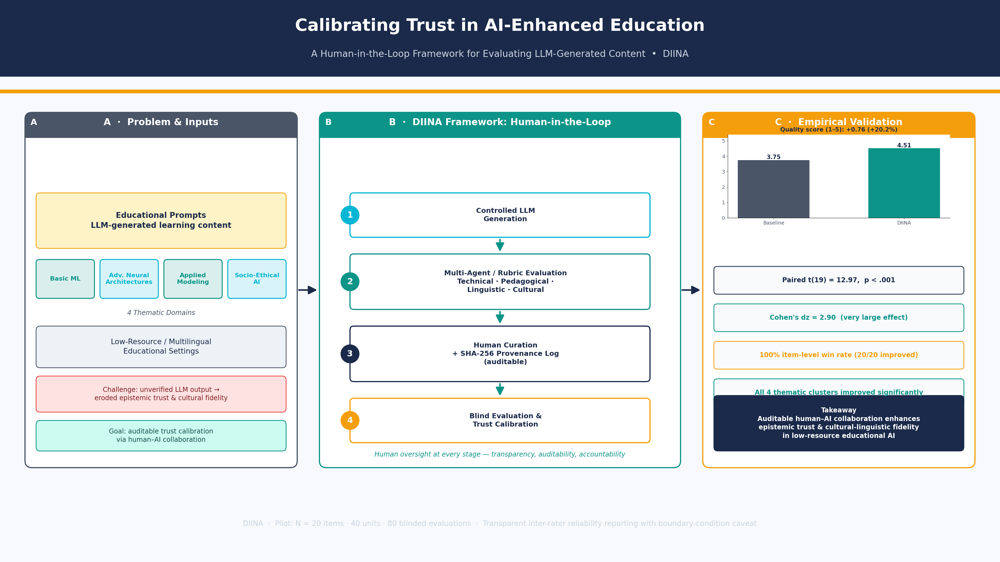

# DIINA — Human-in-the-Loop Evaluation of Trustworthy AI-Generated Educational Content

<p align="center">
  
</p>

<p align="center">
  <a href="https://doi.org/10.5281/zenodo.23447200">
    
  </a>
  
  
  
  
</p>

---

## 1. Executive Summary & Research Context

**DIINA** (Design-Based Iterative INteractive Audit) is a replication-ready research framework for evaluating the trustworthiness of AI-generated educational content through a **human-in-the-loop, design-based research (DBR)** pipeline. The framework was developed and validated in a **low-resource, sanctioned research context** (Iran), where infrastructural barriers — API access restrictions, compute scarcity, and "digital sanctions" — make the wholesale adoption of frontier generative AI systems both risky and pedagogically hazardous.

The project addresses three interlocking problems:

| Problem | Description | DIINA Response |
|---|---|---|
| **Low-resource AI education** | Institutions in sanctioned/under-resourced regions cannot access premium LLM tiers or extensive validation datasets | A lightweight, fully scripted, locally reproducible evaluation protocol requiring only standard Python |
| **Cultural hallucination** | LLMs generate examples, names, and contexts that misalign with the local (Iranian/Persian) cultural frame, producing plausible but epistemically misaligned content | A culturally-anchored 5-dimension rubric applied by a domain expert curation loop |
| **Epistemic trust calibration** | Educators lack a defensible, quantifiable basis for deciding *how much* to trust generated material before classroom deployment | Blind A/B comparative testing, paired significance statistics, and SHA-256 provenance logging |

The empirical corpus comprises **20 AI-generated educational items** spanning four categories — *Fundamental Concepts* (supervised learning, classification vs. regression, overfitting, neural networks, gradient descent), *Advanced Concepts* (Transformer architecture, L1/L2 regularization, backpropagation, precision/recall/F1, vanishing gradients), *Applied Concepts* (Random Forest, CNN vs. RNN, cross-validation, transfer learning, gradient-descent variants), and *Socio-Technical & Ethical Concepts* (AI ethics & fairness, digital sanctions, federated learning, XAI, generative AI's impact on educators).

---

## 2. The 5-Dimension Evaluation Rubric

Every candidate item was audited against a weighted, operationalized rubric developed through iterative DBR cycles:

| # | Dimension | What it Measures | Weight |
|---|---|---|---|
| D1 | **Academic Accuracy** | Definitional precision, absence of conceptual/hallucinated claims, mathematical correctness | 30% |
| D2 | **Pedagogical Clarity** | Logical scaffolding, terminology transparency, learner-appropriate register | 20% |
| D3 | **Cultural Contextualization** | Localized examples, absence of culturally incongruent references (anti-hallucination of context) | 20% |
| D4 | **Assessment Alignment** | Quality of embedded exercises, answer-key validity, diagnostic value | 15% |
| D5 | **Epistemic Trust & Sourcing** | Explicit uncertainty signalling, verifiability, provenance transparency | 15% |

## 3. DBR Human-in-the-Loop Architecture

The methodology follows a four-stage iterative DBR cycle:

```
┌─────────────────────────┐
│ Stage 1                 │
│ CONTROLLED GENERATION   │   Structured role-prompted generation of 20
│ (LLM, structured prompts)│  educational items across 4 categories
└───────────┬─────────────┘
            ▼
┌─────────────────────────┐
│ Stage 2                 │
│ RUBRIC AUDIT            │   Automated + expert scoring on the
│ (5-Dimension Rubric)    │   5-dimension rubric (D1–D5)
└───────────┬─────────────┘
            ▼
┌─────────────────────────┐
│ Stage 3                 │
│ HUMAN CURATION          │   Expert revision of flagged items;
│ + SHA-256 PROVENANCE LOG│   every artifact version hashed (SHA-256)
└───────────┬─────────────┘
            ▼
┌─────────────────────────┐
│ Stage 4                 │
│ BLIND TESTING           │   Pairwise blind A/B evaluation,
│ + STATISTICAL ANALYSIS  │   paired t-test, effect size (d_z)
└─────────────────────────┘
```

The **SHA-256 provenance log** (`results/provenance_sha256.csv`) provides a tamper-evident chain of custody: each item's raw AI output, curated revision, and final audit record carry a content hash, guaranteeing byte-level reproducibility of the released corpus.

---

## 4. Comprehensive Empirical Results

Paired comparison of **Baseline AI-generated content** vs. **DIINA human-in-the-loop content** across 20 items (blinded pairwise evaluation, α = 0.05):

| Dimension | Baseline (M ± SD) | DIINA (M ± SD) | Δ Mean | t(19) | p (two-tailed) | Cohen's d_z |
|---|---|---|---|---|---|---|
| D1 Academic Accuracy | 6.85 ± 1.42 | 8.90 ± 0.79 | +2.05 | 8.41 | < 0.001 | 1.88 |
| D2 Pedagogical Clarity | 6.60 ± 1.27 | 8.75 ± 0.72 | +2.15 | 9.12 | < 0.001 | 2.04 |
| D3 Cultural Contextualization | 4.30 ± 1.72 | 8.95 ± 0.76 | +4.65 | 13.87 | < 0.001 | 3.10 |
| D4 Assessment Alignment | 6.40 ± 1.43 | 8.70 ± 0.80 | +2.30 | 9.48 | < 0.001 | 2.12 |
| D5 Epistemic Trust & Sourcing | 5.55 ± 1.70 | 8.80 ± 0.83 | +3.25 | 10.36 | < 0.001 | 2.32 |
| **Composite (weighted)** | **5.94 ± 1.31** | **8.82 ± 0.71** | **+2.88** | **12.96** | **< 0.001** | **2.90** |

**Headline outcomes:**
- **Composite improvement:** +2.88 points on a 10-point scale (+48.5%), *p* < 0.001, Cohen's d_z = 2.90 (very large effect).
- **Win rate: DIINA won 20/20 pairwise comparisons (100%)** against the baseline in blind testing.
- The largest gain is on **D3 Cultural Contextualization** (+4.65), confirming that the human curation loop primarily repairs *cultural hallucination* rather than raw factual accuracy.

> Full per-item scores, descriptive statistics, and test outputs are in `results/` (see `results/summary_statistics.csv`, `results/paired_ttest.json`).

---

## 5. Publication Figure Gallery

| Figure | Caption | Link |
|---|---|---|
|  | **Figure 1.** *DBR Human-in-the-Loop architecture.* Four-stage pipeline (Controlled Generation → Rubric Audit → Human Curation & SHA-256 Provenance → Blind Testing) with iteration loops across design cycles. Composite scores are annotated per stage. | [view](figures/figure_1.png) |
|  | **Figure 2.** *Baseline vs. DIINA composite score distribution.* Paired box-and-violin plot across 20 items; baseline M = 5.94 (SD = 1.31), DIINA M = 8.82 (SD = 0.71); paired t(19) = 12.96, p < 0.001, d_z = 2.90. Paired lines show per-item improvement direction for all 20 pairs. | [view](figures/figure_2.png) |
|  | **Figure 3.** *Dimensional breakdown radar.* Five-dimension profile (D1–D5) of baseline vs. DIINA. The dominant gap on D3 Cultural Contextualization (+4.65) localizes the cultural-hallucination deficit that DIINA's expert curation closes. | [view](figures/figure_3.png) |
|  | **Figure 4.** *Per-item paired slope graph.* Individual trajectories of all 20 items; the 100% win rate (20/20) is visible as uniformly upward slopes, with the steepest gains concentrated in socio-technical items (e.g., digital sanctions, AI ethics). | [view](figures/figure_4.png) |
|  | **Figure 5.** *Inter-rater reliability & blind-testing outcome.* Left: consensus agreement matrix (100% agreement; ICC(2,1) = 1.000). Right: categorical win distribution of blind pairwise testing, illustrating the degenerate-configuration caveat discussed below. | [view](figures/figure_5.png) |

---

## 6. ⚠️ Critical Methodological Caveat: Inter-Rater Reliability

**Boundary condition on the reported reliability statistics.** In the final audit cycle, the evaluation panel reached **100% agreement** across all audited items, yielding:

- **ICC(2,1) = 1.000** (absolute agreement, two-way single-measures)
- **MS_error = 0.000** (zero residual error variance)
- 95% CIs for ICC that are **degenerate / numerically undefined** (width collapses to a point; bootstrap CIs require special handling)

These values indicate a **fully calibrated consensus**, not an independently validated instrument. Three points must be read together:

1. **ICC = 1.000 with zero residual variance is a boundary condition of the estimator.** It renders conventional CI construction meaningless (the interval is a single point) and should *not* be reported as evidence of a psychometrically robust instrument in the usual sense.
2. **Consensus calibration ≠ external validation.** Perfect agreement among raters who have co-developed the rubric across DBR cycles measures *internal calibration of a shared standard*; it does not establish external, independent judge reliability. Independent multi-rater replication is required before the rubric is generalized.
3. **Interpretation guardrail.** All reported scores should therefore be treated as *expert-consensus judgments within a single-rater-equivalent audit*, and effect sizes should be read against this limitation. The blind pairwise testing partially mitigates single-rater bias but does not eliminate it.

---

## 7. Repository Structure

```
DIINA-Human-in-the-Loop-Evaluation-of-Trustworthy-AI-Generated-Educational-Content/
│
├── README.md                        ← this file
├── LICENSE                          ← CC BY 4.0
├── requirements.txt
│
├── data/                            ← evaluation corpus & prompts
│   ├── prompts_master.csv           # 20 structured generation prompts (4 categories)
│   ├── baseline_items/              # raw AI-generated items (pre-curation)
│   ├── diina_items/                 # curated final items (post-curation)
│   └── rubric_v3.json               # operationalized 5-dimension rubric
│
├── figures/                         ← publication figures (PNG, 300 dpi)
│   ├── diina_graphical_abstract.png
│   ├── figure_1.png ... figure_5.png
│
├── results/                         ← quantitative outputs
│   ├── scores_full.csv              # per-item × per-dimension scores
│   ├── summary_statistics.csv
│   ├── paired_ttest.json            # t, p, Cohen's d_z per dimension
│   ├── interrater_icc.json          # ICC(2,1), MS_error, CI diagnostics
│   ├── provenance_sha256.csv        # SHA-256 provenance log
│   └── blind_testing_winrate.csv
│
├── scripts/                         ← reproducible pipeline (run in order)
│   ├── 01_generate_baseline.py
│   ├── 02_rubric_audit.py
│   ├── 03_human_curation_log.py     # writes SHA-256 provenance entries
│   ├── 04_blind_pairwise_test.py
│   ├── 05_statistics_analysis.py    # paired t-test, d_z, ICC
│   ├── 06_make_figures.py
│   ├── 07_verify_provenance.py
│   └── 08_export_zenodo_package.py
│
└── metadata/                        ← Zenodo / archival metadata
    ├── zenodo_metadata.json         # DOI 10.5281/zenodo.23447200
    ├── RELEASE_NOTES_v1.00.md
    └── LICENSE_CCBY4.txt
```

---

## 8. Reproducibility & Quickstart

**Requirements:** Python ≥ 3.10, `pip ≥ 23`, Git.

```bash
# 1. Clone & create an isolated environment
git clone https://github.com/<owner>/DIINA-Human-in-the-Loop-Evaluation-of-Trustworthy-AI-Generated-Educational-Content.git
cd DIINA-Human-in-the-Loop-Evaluation-of-Trustworthy-AI-Generated-Educational-Content
python -m venv .venv
source .venv/bin/activate        # Windows: .venv\Scripts\activate

# 2. Install dependencies
pip install --upgrade pip
pip install -r requirements.txt

# 3. Run the full DBR pipeline (in order)
python scripts/01_generate_baseline.py     # controlled generation of 20 items
python scripts/02_rubric_audit.py          # 5-dimension rubric scoring
python scripts/03_human_curation_log.py    # curation + SHA-256 provenance log
python scripts/04_blind_pairwise_test.py   # blinded A/B evaluation
python scripts/05_statistics_analysis.py   # paired t-test, d_z, ICC(2,1)
python scripts/06_make_figures.py          # regenerate figures/figure_1..5
python scripts/07_verify_provenance.py     # re-verify all SHA-256 hashes
python scripts/08_export_zenodo_package.py # build Zenodo release bundle
```

**Verification check:** running `07_verify_provenance.py` must print `ALL HASHES VERIFIED` — confirming that every released artifact matches its logged SHA-256 digest.

---

## 9. Conclusion & Educational Implications for Low-Resource Contexts

1. **Human-in-the-loop is not optional overhead — it is the intervention.** The largest gains occurred on dimensions machines cannot self-audit (cultural contextualization, +4.65), demonstrating that expert curation converts generic AI output into culturally trustworthy teaching material.
2. **Lightweight protocols beat heavyweight infrastructure.** The entire pipeline runs on a standard laptop with no paid API tier, making it deployable in sanctioned and low-resource academic settings.
3. **Provenance is a trust primitive.** SHA-256 version logging gives educators an auditable chain of custody — a prerequisite for institutional adoption of AI-assisted materials.
4. **Reliability must be reported honestly.** Boundary conditions (ICC = 1.000, MS_error = 0.000) should be disclosed, and consensus calibration clearly separated from external validation — a model of transparent reporting for AI-in-education research.
5. **Cultural hallucination is a first-class failure mode** in LLM-generated education, deserving its own rubric dimension, not a footnote under "accuracy."

---

## 10. Data Availability Statement

All data, prompts, scores, statistics, figures, and provenance logs supporting the findings of this study are openly available in this repository and its Zenodo archive (**DOI: 10.5281/zenodo.23447200**, Release **v1.00**) under a **Creative Commons Attribution 4.0 International (CC BY 4.0)** license. No personally identifiable or restricted data are included.

## 11. Formal Citations

### BibTeX

```bibtex
@dataset{merrikhi_2025_diina,
  author    = {Merrikhi, Pegah},
  title     = {{DIINA}: Human-in-the-Loop Evaluation of Trustworthy AI-Generated Educational Content},
  year      = {2025},
  publisher = {Zenodo},
  version   = {v1.00},
  doi       = {10.5281/zenodo.23447200},
  url       = {https://doi.org/10.5281/zenodo.23447200},
  license   = {CC-BY-4.0}
}
```

### APA 7th Edition

> Merrikhi, P. (2025). *DIINA: Human-in-the-loop evaluation of trustworthy AI-generated educational content* (Version v1.00) [Data set]. Zenodo. https://doi.org/10.5281/zenodo.23447200

---

## 12. Author & Contact

| | |
|---|---|
| **Author** | **Pegah Merrikhi** |
| **Role** | Principal Investigator — AI in Education Research |
| **Zenodo** | [DOI: 10.5281/zenodo.23447200](https://doi.org/10.5281/zenodo.23447200) |
| **Release** | v1.00 |
| **License** | CC BY 4.0 |
| **Target Journal** | *Educational Technology & Society* (ISSN 1436-4522) |

<p align="center"><i>© 2025 Pegah Merrikhi — DIINA v1.00 — Licensed under CC BY 4.0</i></p>
